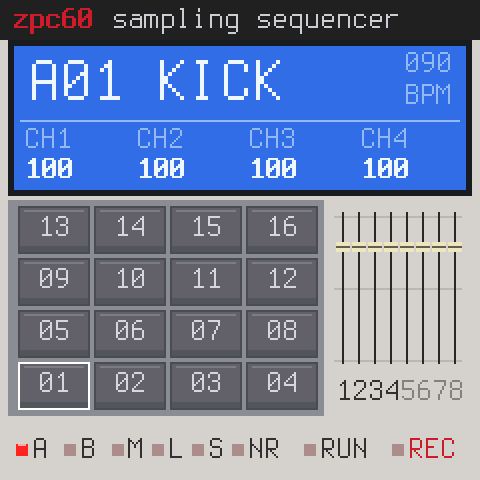
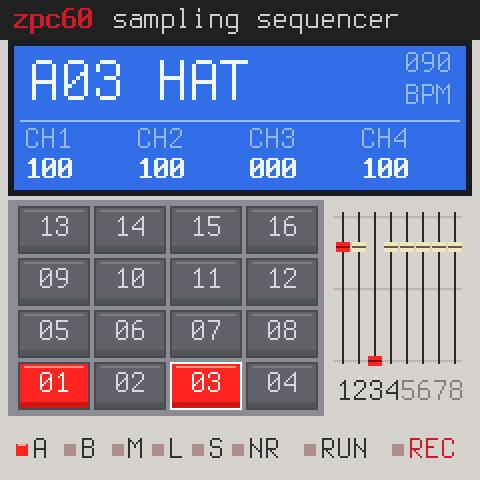
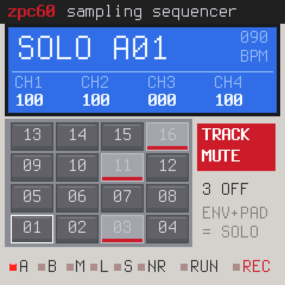
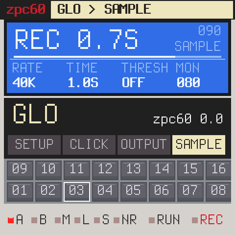

<h1 align="center">zpc60</h1>

<b>A 12-bit sampling sequencer for the M-VAVE FM-1</b>, after the drum machines of the late 80s: 
4 × 4 pads, 40 kHz, note repeat, 16 levels, track mute, and sampling on the machine itself.

  
  
  

  
  
  
  

zpc60 is a fork of [zp12](https://github.com/zvenson/zp12) (the SP-1200-style sampler) that turns the FM-1 into a
sampling sequencer in the spirit of the late-80s machines: a beige-grey panel, a blue LCD, two banks of 16 pads,
12-bit sound at 40 kHz, the swing, note repeat and 16 levels you know from them. Inspired by them; their names are
trademarks of their owners, no affiliation.

> **Status: 0.1** (2026-10-24), a first version. Install it from **[the Firmware Hub](https://thefirmwarehub.com/)**
> (Chrome or Edge, USB). Cheat sheet: [web/zpc60-cheat-sheet.pdf](web/zpc60-cheat-sheet.pdf).
> Your FM-1 can go back to the official firmware or any other one at any time.

## What it does

- **Two banks of 16 pads** on the 16 white keys (pad 01 bottom left on the screen; OCT+ bank B). A factory kit at
  **40 kHz, 12 bit**, pitched without interpolation: bank A a whole kit, bank B its darker and retuned twins.
- **8 channels**, each with its fader (KNOB 1–4, SEL: 5–8): a pad plays on its place in the row pair (pads 01 and 09
  on channel 1 …), so a hat and an open hat choke each other. Channels 1–2 have the resonant filter.
- **The sequencer** from zp12: 16 loops of 1–32 bars or AUTO, real-time recording with count-in and AUTO CORRECT,
  swing, overdub, step editing (hold SEQ), four songs, undo.
- **NOTE REPEAT**: hold **ENV** and pads: they repeat on every step of AUTO CORRECT (1/16 when it is off), swung,
  recorded while REC runs. ENV tapped is still tap tempo.
- **16 LEVELS**: **ARP** twice: the white keys play the last pad at 16 velocities (ARP once: MULTI PITCH over 27 keys).
  Hits are saved with 16 levels.
- **TRACK MUTE** per pad: **HOME** on the main page, then a white key mutes / unmutes its pad (the loop stops
  playing it, live it still sounds); ENV held + a pad: solo. Muted pads are greyed out, the screen says TRACK MUTE.
- **Sampling on the machine, over USB**: the FM-1 is your computer's (or phone's) speaker, **zpc60 FM-1**. Play
  anything into it, hit the pad, tap **LFO**, press **REC**: it erases its room (ERASE %), waits for the sound if you
  set THRESH, takes it at 40, 26 or 20 kHz and puts it on the pad. Again on that pad: the new take replaces it.
  **EDIT → WAVE → DELETE** (KNOB 4, twice) frees it. The computer's volume slider only sets what you hear (MON).
- zp12's **effects**: chorus, delay, reverb sends per pad, a DJ filter, punch-in (FX + white 1–4) and REV / ECHO throw.

## The room

The flash outside the app is shared by every FM-1 firmware. zpc60 keeps its save where zp12 does (its own format: it
never reads a zp12 save; switching back and forth, the last one saving wins) and its own samples in zp12's rooms:
about **1.2 s at 40 kHz** free, more at 26 or 20 kHz, more again with sloopDX's bank room (allowed in the
[zp12 sample editor](https://zp12.designburgapps.com/editor/), which works with zpc60 too). Recording your own
samples overwrites what other firmwares kept in those rooms (OberVave's patterns at 0xF4000–0xFBFFF among them):
back up first.

## Build

As zp12 (see [BUILDING.md](BUILDING.md) and [CLAUDE.md](CLAUDE.md)): `./build.sh` (dev, identity FM-1_6000) or
`./build.sh --release 0.1` (FM-1_6001: FM-1_60XY = release X.Y). Host tests in `tests/` (the sequencer, the screen
with the device's 80-row canvas, the sampler with a simulated flash and USB stream).

## Credits

zpc60 is built on **zp12** (zvenson), which is built on **SLOOP** (isod89) and **Felucca** (Leo Kuroshita, Hügelton
Instruments): GPL-3.0, see [LICENSING.md](LICENSING.md). Factory sounds CC0 (VSCO-2 CE, Sonic Pi, SLOOP's hip-hop
pack); the E-piano by Greg Sullivan (CC BY 3.0). The update loader's screen after the idea from Skiff (illuminus5).
M-VAVE and FM-1 are trademarks of their owners; zpc60 is not affiliated with M-VAVE or Akai.
